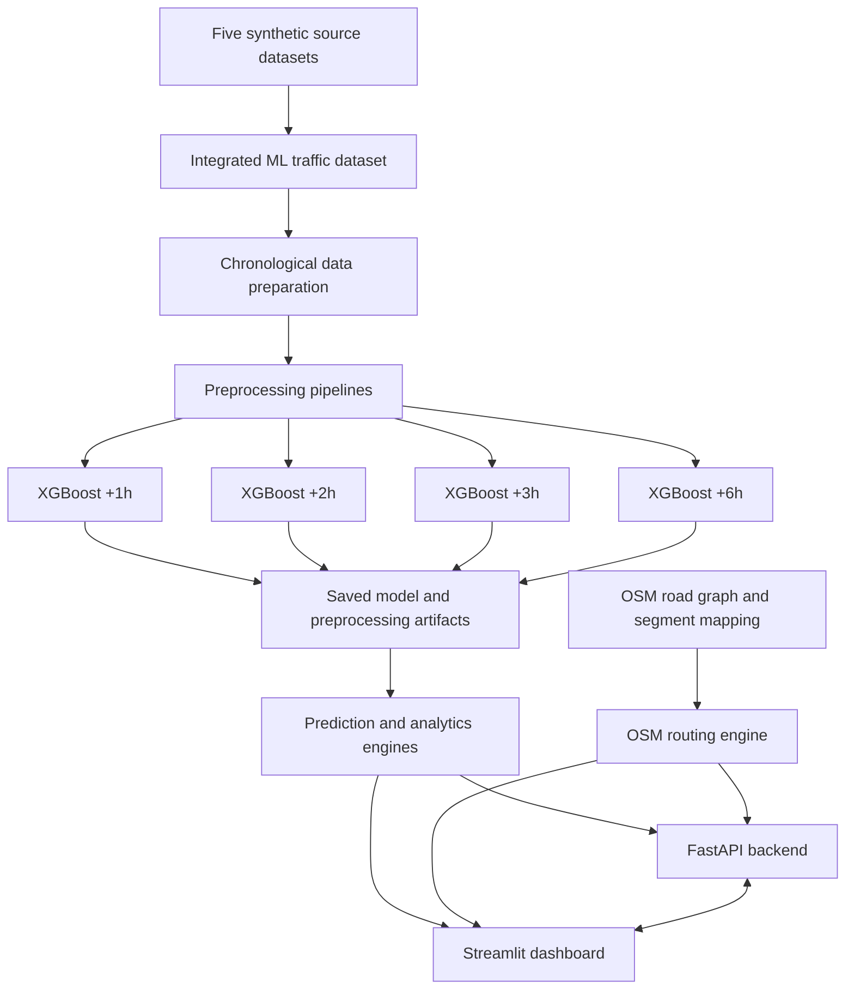

# Smart AI Traffic Congestion Prediction and Reduction System Using Explainable Machine Learning and OpenStreetMap-Based Routing

A Hyderabad-focused academic traffic-intelligence prototype that combines multi-horizon congestion forecasting, explainable machine learning, hotspot analysis, anomaly screening, OpenStreetMap (OSM)-based route calculation, a FastAPI backend, and an interactive Streamlit dashboard.

> **Scope note:** This project currently uses a synthetic academic traffic dataset with historical records for 2025. It is a decision-support prototype, not a live traffic-monitoring or navigation service. It does not control traffic signals or establish a measured real-world reduction in congestion.

---

## Contents

- [Project overview](#project-overview)
- [Main capabilities](#main-capabilities)
- [System architecture](#system-architecture)
- [Dataset](#dataset)
- [Machine-learning workflow](#machine-learning-workflow)
- [Recorded model results](#recorded-model-results)
- [Project structure](#project-structure)
- [Requirements](#requirements)
- [Installation](#installation)
- [Run the application](#run-the-application)
- [API endpoints](#api-endpoints)
- [Train and evaluate the forecasting models](#train-and-evaluate-the-forecasting-models)
- [Tests and validation](#tests-and-validation)
- [Documentation](#documentation)
- [Limitations](#limitations)

## Project overview

Urban traffic conditions can vary with traffic demand, road characteristics, weather, accidents, events, and time of day. This project brings several traffic-analysis capabilities into one application so that users can inspect congestion forecasts and related decision-support information.

The platform includes four independently trained XGBoost classifiers that forecast one of five congestion classes at **+1, +2, +3, and +6 hours**. It also provides model explanations with SHAP, geographic grouping of road segments, anomaly indicators, and candidate routes over a stored Hyderabad OSM road graph.

## Main capabilities

| Module | Description |
|---|---|
| Traffic overview | Displays summary traffic information and charts from the project dataset. |
| Congestion prediction | Provides congestion-class predictions and class probabilities. |
| Multi-horizon forecasting | Produces forecasts for +1h, +2h, +3h, and +6h using separate XGBoost models. |
| Explainable AI | Uses SHAP feature contributions to help interpret model predictions. |
| Hotspot detection | Uses DBSCAN to group geographically close project road segments and summarize their traffic characteristics. |
| Anomaly detection | Uses Isolation Forest and a z-score rule to flag unusual records for review. |
| OSM route optimization | Calculates candidate routes over a stored OpenStreetMap road graph, applying traffic-related edge costs when mapped traffic data is available. |
| Reports | Generates daily, weekly, and anomaly summaries from the available dataset. |
| AI and voice assistants | Provides assistant interfaces for interacting with available project traffic information and functions. |
| REST API | Exposes core traffic, prediction, forecasting, hotspot, anomaly, and routing functionality through FastAPI. |

## System architecture



The training workflow is implemented in `engine/multihorizon_forecaster.py`. The application loads the saved artifacts for inference; model training is not required every time the dashboard starts.

## Dataset

The project uses a custom **synthetic Hyderabad-focused academic dataset**. The integrated dataset contains **525,480 hourly records across 60 road segments**, covering **1 January 2025 through 31 December 2025**.

| Dataset | Recorded rows | Recorded columns |
|---|---:|---:|
| `road_segments.csv` | 60 | 9 |
| `traffic_data.csv` | 525,480 | 27 |
| `weather_data.csv` | 175,200 | 8 |
| `accidents.csv` | 600 | 9 |
| `events.csv` | 350 | 9 |
| `ml_traffic_dataset.csv` | 525,480 | 31 |

The integrated model dataset is expected at:

```text
data/final_dataset/ml_traffic_dataset.csv
```

The five congestion classes are **Free Flow, Low, Moderate, High, and Severe**. The data are synthetic, not collected from live traffic sensors or an official real-time feed.

## Machine-learning workflow

### Current training implementation

The current multi-horizon training code is:

```text
engine/multihorizon_forecaster.py
```

It loads and validates the integrated dataset, constructs the horizon-specific target, prepares features, creates chronological training/validation/test partitions, fits preprocessing pipelines, trains the XGBoost models, evaluates held-out test predictions, and saves the artifacts.

The horizon target setup is:

```python
HORIZONS = {
    1: 0,
    2: 1,
    3: 2,
    6: 5,
}
```

The existing `future_congestion_level` target is used for +1 hour. Longer-horizon targets are formed by shifting that target within each `road_segment_id` by the configured number of hourly records. Records without a future target at the end of a segment's timeline are excluded for that horizon.

### Preprocessing

- Numerical features: median imputation.
- Categorical features: most-frequent imputation followed by one-hot encoding.
- The preprocessor is fitted on the training partition and then applied to the validation and test partitions.
- The observed transformed feature count is 117.

### XGBoost configuration

The current `build_model()` function uses the following configuration for each horizon:

| Parameter | Value |
|---|---:|
| `objective` | `multi:softprob` |
| `eval_metric` | `mlogloss` |
| `n_estimators` | 180 |
| `max_depth` | 8 |
| `learning_rate` | 0.10 |
| `subsample` | 0.90 |
| `colsample_bytree` | 0.90 |
| `min_child_weight` | 1 |
| `reg_lambda` | 1.0 |
| `random_state` | 42 |
| `n_jobs` | -1 |
| `tree_method` | `hist` |

### Saved model artifacts

Each horizon has its own directory under `trained_models/multihorizon/` containing:

- `xgb_congestion.json` — trained XGBoost model.
- `traffic_preprocessor.joblib` — fitted preprocessing pipeline.
- `label_encoder.joblib` — congestion-label encoder.
- `metadata.json` — horizon, split, metrics, and artifact metadata.

The parent directory also contains `multihorizon_summary.json` and `validation_report.json`.

## Recorded model results

The following results were reproduced by running the current training script and then separately evaluating the saved models on their held-out chronological test partitions.

| Forecast horizon | Accuracy | Balanced accuracy | Macro F1 | Weighted F1 |
|---|---:|---:|---:|---:|
| +1 hour | 63.60% | 48.52% | 48.33% | 61.82% |
| +2 hours | 63.66% | 48.89% | 49.32% | 62.10% |
| +3 hours | 63.53% | 49.06% | 48.71% | 61.86% |
| +6 hours | 63.58% | 48.21% | 48.29% | 61.52% |

The +2-hour model has the highest recorded accuracy (63.66%) and weighted F1 (62.10%). The +3-hour model has the highest balanced accuracy (49.06%). The class-wise results are uneven, with weaker recall for the `Low` class. Accuracy should therefore be interpreted alongside balanced accuracy, macro F1, weighted F1, and the class-wise reports.

**These are classification metrics on held-out synthetic test records. They are not percentages of congestion reduction, vehicles rerouted, or real-world traffic accuracy.**

## Project structure

The following is an overview of the principal project directories and files. It is not an exhaustive listing; additional helper modules and assets may be present.

```text
minor_project/
├── api/                         # FastAPI application and route modules
├── dashboard/                   # Streamlit dashboard panels
├── data/
│   ├── final_dataset/            # Source datasets and integrated ML dataset
│   └── osm/                      # Stored Hyderabad OSM road graph and mapping data
├── engine/                       # Forecasting, routing, and decision-support engines
│   └── multihorizon_forecaster.py # Current multi-horizon training implementation
├── models/                       # Prediction, explainability, hotspot, and anomaly modules
├── nlp/                          # AI assistant, language, and voice modules
├── reports/                      # Report-generation logic
├── tests/                        # Automated tests and validation scripts
├── trained_models/
│   └── multihorizon/              # Saved 1h, 2h, 3h, and 6h model artifacts
├── docs/                          # Project documentation
├── app.py                         # Streamlit application entry point
├── requirements.txt               # Main application dependencies
└── requirements-dev.txt           # Development and test dependencies
```

Important OSM files used by the route engine:

```text
data/osm/hyderabad_drive.graphml
data/osm/hyderabad_drive.pkl
```

Keep the dataset, OSM graph, model files, and their associated preprocessing/label-encoding artifacts in the expected locations. The application may fail to load a module if required data or artifacts are missing.

## Requirements

- Windows, macOS, or Linux with a compatible Python installation.
- The project dependency files: `requirements.txt` and `requirements-dev.txt`.
- Sufficient memory and disk space for the dataset, model artifacts, and OSM graph.
- Internet access may be needed for external map tiles and any configured translation or external service features.

The main dependencies include FastAPI, Uvicorn, Streamlit, pandas, NumPy, scikit-learn, XGBoost, SHAP, Plotly, Matplotlib, Folium, NetworkX, joblib, and the NLP/assistant packages listed in `requirements.txt`.

## Installation

### 1. Open the project root

In PowerShell, change to the folder containing `app.py` and `requirements.txt`:

```powershell
cd "C:\path\to\minor_project"
```

For the current development machine, the project folder has been:

```powershell
cd "$HOME\OneDrive\Desktop\minor_project"
```

### 2. Create and activate a virtual environment

```powershell
py -m venv .venv
.\.venv\Scripts\Activate.ps1
```

If PowerShell blocks script activation for the current terminal session, run:

```powershell
Set-ExecutionPolicy -Scope Process -ExecutionPolicy Bypass
.\.venv\Scripts\Activate.ps1
```

### 3. Install dependencies

```powershell
python -m pip install --upgrade pip
python -m pip install -r requirements.txt
python -m pip install -r requirements-dev.txt
```

Check dependency consistency:

```powershell
python -m pip check
```

Expected healthy output:

```text
No broken requirements found.
```

## Run the application

The application uses two processes. Start each service in a separate terminal, with both terminals opened at the project root and using the same virtual environment.

### Terminal 1: FastAPI backend

```powershell
cd "$HOME\OneDrive\Desktop\minor_project"
.\.venv\Scripts\Activate.ps1
python -m uvicorn api.main:app --host 127.0.0.1 --port 8000
```

Health check:

```powershell
Invoke-RestMethod -Uri "http://127.0.0.1:8000/health" | ConvertTo-Json -Depth 5
```

Expected response structure:

```json
{
  "status": "healthy",
  "service": "ai-traffic-intelligence-api",
  "version": "1.0.0"
}
```

### Terminal 2: Streamlit dashboard

```powershell
cd "$HOME\OneDrive\Desktop\minor_project"
.\.venv\Scripts\Activate.ps1
python -m streamlit run app.py
```

Open the local address printed by Streamlit. The standard local address is:

```text
http://127.0.0.1:8501
```

### API interactive documentation

With FastAPI running, open:

```text
http://127.0.0.1:8000/docs
```

Use the live API schema shown there for request-body details.

## API endpoints

| Method | Endpoint | Purpose |
|---|---|---|
| GET | `/health` | API health check. |
| GET | `/api/v1/traffic/{area}` | Retrieve traffic information for an area. |
| GET | `/api/v1/hotspots` | Retrieve hotspot results. |
| GET | `/api/v1/anomalies` | Retrieve anomaly results. |
| POST | `/api/v1/predict` | Generate a congestion prediction. |
| POST | `/api/v1/route` | Calculate a route over the OSM road graph. |
| POST | `/api/v1/forecast` | Generate forecasts for the supported horizons. |

## Train and evaluate the forecasting models

> **Warning:** The training command retrains all four models and overwrites the corresponding saved model artifacts, metadata, and summary files. Back up `trained_models/multihorizon/` before retraining. Do not run this command during a live demonstration unless retraining is intended.

### Train all horizons

Run from the project root with the virtual environment activated:

```powershell
python .\engine\multihorizon_forecaster.py
```

The script trains the +1h, +2h, +3h, and +6h models and prints their test metrics.

### Independently evaluate the saved models

The evaluation script is:

```text
tests/validate_multihorizon.py
```

Run from the project root:

```powershell
$env:PYTHONPATH = (Get-Location).Path
python .\tests\validate_multihorizon.py
Remove-Item Env:PYTHONPATH
```

This script loads the saved models and their matching preprocessing/label-encoding artifacts, evaluates test predictions, prints class-wise metrics and confusion matrices, and writes:

```text
trained_models/multihorizon/validation_report.json
```

This is an evaluation run; it does not retrain the saved models.

## Tests and validation

Run the automated test suite:

```powershell
python -m pytest -v
```

Run multi-horizon inference validation:

```powershell
python .\tests\validate_forecast_inference.py
```

The previously recorded inference validation covered all 60 road segments, with 60 successful validations, zero failures, and the expected horizons `1h`, `2h`, `3h`, and `6h`.

Check dependencies:

```powershell
python -m pip check
```

A previous full regression run recorded 24 passing tests. Re-run the suite on the exact copy being submitted, especially after code, dependency, or model changes.

## Documentation

The `docs/` folder is intended to contain the supporting project guides:

- [`ML_TRAINING_AND_EVALUATION.md`](docs/ML_TRAINING_AND_EVALUATION.md) — current training workflow, model configuration, evaluation metrics, and results.
- [`SYSTEM_ARCHITECTURE_AND_API.md`](docs/SYSTEM_ARCHITECTURE_AND_API.md) — architecture, components, and API overview.
- [`PROJECT_SETUP_AND_USER_GUIDE.md`](docs/PROJECT_SETUP_AND_USER_GUIDE.md) — installation, startup, dashboard usage, and troubleshooting.
- [`VIVA_PREPARATION_GUIDE.md`](docs/VIVA_PREPARATION_GUIDE.md) — presentation sequence and viva preparation.

If any of these files have not yet been copied into `docs/`, add them before sharing the repository so the links work.

## Limitations

- The traffic dataset is synthetic academic data, not a live Hyderabad traffic feed.
- The recorded observations cover 2025; timestamps displayed by the application refer to historical dataset time.
- Class-wise model performance is uneven, particularly for the `Low` class. Aggregate accuracy alone does not describe performance across all classes.
- Model accuracy is not a percentage of congestion removed or traffic reduced.
- SHAP explains model outputs; it does not prove that changing a feature will cause congestion to decrease.
- Anomaly flags identify unusual records for review; they do not confirm real-world incidents.
- OSM routes are candidate paths over the stored road graph. Traffic-aware usefulness depends on mapped traffic data being available for the route and selected timestamp.
- The current prototype does not ingest live GPS/sensor traffic feeds, control traffic signals, or provide measured before-and-after evidence of real-world congestion reduction.
- Independent validation against real external traffic data is required before operational deployment.

---

## Acknowledgement of project scope

This repository documents an academic prototype developed using synthetic traffic data and locally stored road-network data. Results should be interpreted within that scope. Contributions, extensions, and future integrations should preserve clear distinctions between historical synthetic analysis, model predictions, route calculations, and verified real-world traffic outcomes.
